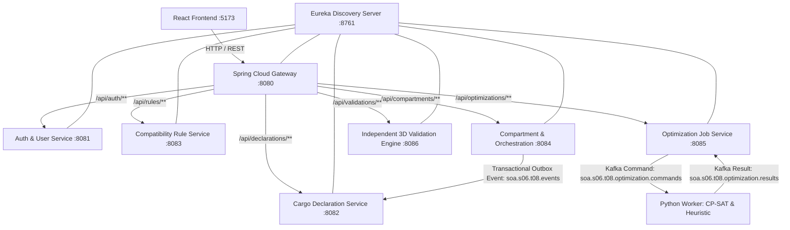

# SOA Team 8 — Hazardous Cargo Freight Planning Platform

[](https://openjdk.org/projects/jdk/21/)
[](https://spring.io/projects/spring-boot)
[](https://www.python.org/)
[](https://developers.google.com/optimization)
[](https://react.dev/)

A distributed, enterprise-grade multi-service platform for hazardous freight load planning, multi-hazard compatibility segregation, 3D cargo packing optimization (Google OR-Tools CP-SAT with deterministic heuristic fallbacks), independent zero-trust Java 3D validation gates, and human load-planner governance.

---

## 1. System Architecture & Component Roles



### Microservice Inventory & Port Allocations

| Component | Technology | Default Port | Description |
| :--- | :--- | :--- | :--- |
| **Eureka Service Discovery** | Spring Cloud Netflix Eureka | `8761` | Service registration and heartbeat monitoring |
| **API Gateway** | Spring Cloud Gateway | `8080` | Unified edge routing, CORS handling, JWT relay |
| **Auth Service** | Spring Boot + Spring Security | `8081` | JWT token issuance, RBAC (`ROLE_SHIPPER`, `ROLE_LOAD_PLANNER`, `ROLE_ADMIN`) |
| **Cargo Declaration Service** | Spring Boot + Spring Data JPA | `8082` | Cargo declaration creation, items catalog, workflow projection |
| **Compatibility Rule Service** | Spring Boot + Spring Data JPA | `8083` | India CMV hazard rules, versioned immutable rule snapshots (`snap-2026-q4-v1`) |
| **Compartment Service** | Spring Boot + Spring Data JPA | `8084` | Assessment lifecycle, layout recording, approval/rejection gates, transactional outbox |
| **Optimization Service** | Spring Boot + Spring Kafka | `8085` | Durable async optimization jobs, command dispatch, idempotent result consumption |
| **Validation Service** | Spring Boot + Spring Data JPA | `8086` | Independent zero-trust Java 3D bounding, physics support, and hazard rule verification |
| **Optimizer Worker** | Python 3.12 + OR-Tools CP-SAT | External Daemon | Bounded 3-stage lexicographic CP-SAT cargo solver with SQLite deduplication store |
| **Frontend Dashboard** | React 18 + Vite + TypeScript | `5173` | Interactive visualizer, cargo declaration editor, approval console |

---

## 2. Prerequisites & Environment Setup

### Software Requirements
- **Java 21 LTS** (Amazon Corretto, Eclipse Temurin, or Oracle JDK 21)
- **Apache Maven 3.9+**
- **Python 3.12+**
- **Node.js 20+** and **npm**
- **Docker Desktop** (optional for live multi-container infrastructure; all Spring Boot services run embedded H2 databases out-of-the-box if external MySQL is absent).

### Python Virtual Environment Setup
```bash
# Navigate to the Python optimizer worker directory
cd workers/optimizer-worker

# Install dependencies (Google OR-Tools, kafka-python, pytest)
pip install -r requirements.txt
```

---

## 3. Infrastructure Startup Commands

### Option A: Live Docker Infrastructure (MySQL & Kafka Broker)
When Docker Desktop is installed and running:
```bash
# From workspace root:
docker compose up -d
```
This initializes:
- **MySQL 8.3** on `localhost:3306` with pre-created schemas: `auth_db`, `cargo_declaration_db`, `compatibility_rules_db`, `compartment_db`, `optimization_db`, `validation_db` (initialized via `docker/mysql-init/init.sql`).
- **Apache Kafka 7.6.1** on `localhost:9092` (managed via Zookeeper on `2181`).

### Option B: In-Memory / Lightweight Fallback Mode
Each Spring Boot service defaults to an isolated in-memory H2 database (`jdbc:h2:mem:...`) with `ddl-auto: update`, allowing full development, integration testing, and local execution without requiring a live MySQL daemon.

---

## 4. Microservices Startup Order

To run the complete distributed platform locally, launch services in separate terminal windows in the following required order:

```bash
# 1. Service Discovery (Wait until http://localhost:8761 is responsive)
mvn -pl service-discovery spring-boot:run

# 2. Spring Cloud API Gateway (Edge routing on http://localhost:8080)
mvn -pl api-gateway spring-boot:run

# 3. Domain & Governance Services
mvn -pl auth-service spring-boot:run
mvn -pl cargo-declaration-service spring-boot:run
mvn -pl compatibility-rule-service spring-boot:run
mvn -pl compartment-service spring-boot:run
mvn -pl validation-service spring-boot:run
mvn -pl optimization-service spring-boot:run

# 4. Python Optimizer Worker (Consumes from soa.s06.t08.optimization.commands)
python workers/optimizer-worker/worker.py

# 5. React Frontend Web Application (Available on http://localhost:5173)
cd frontend
npm run dev
```

---

## 5. Synthetic Demo Credentials & Seed Data

The platform comes pre-seeded with synthetic test identities and statutory hazard separation rules:

### Demo Users (`auth-service`)
| Username | Password | Role | Permitted Actions |
| :--- | :--- | :--- | :--- |
| `shipper@soa8.org` | `ShipperPass123!` | `ROLE_SHIPPER` | Create declarations, add cargo items, trigger assessments |
| `planner@soa8.org` | `PlannerPass123!` | `ROLE_LOAD_PLANNER` | Submit optimization jobs, review validation findings, Approve / Reject layouts |
| `admin@soa8.org` | `AdminPass123!` | `ROLE_ADMIN` | Governance, rule snapshot publishing, audit compliance |

### Default Pinned Compatibility Rule Snapshot (`snap-2026-q4-v1`)
- **`CMV-HAZ-1-3`**: Explosives (Class 1) and Flammable Liquids (Class 3) must be segregated by at least **3,000 mm**.
- **`CMV-HAZ-1-2.1`**: Co-loading Explosives (Class 1) and Flammable Gases (Class 2.1) is **FORBIDDEN**.
- **`CMV-HAZ-4.3-8`**: Dangerous When Wet (Class 4.3) and Corrosives (Class 8) must be segregated by at least **2,000 mm**.

---

## 6. Step-by-Step End-to-End API Workflow Demo

Below is the verified end-to-end execution workflow using standard `curl` commands.

### Step 1: Authenticate as Shipper
```bash
SHIPPER_TOKEN=$(curl -s -X POST http://localhost:8080/api/auth/login \
  -H "Content-Type: application/json" \
  -d '{"username":"shipper@soa8.org","password":"ShipperPass123!"}' \
  | jq -r '.token')
echo "Shipper Token: $SHIPPER_TOKEN"
```

### Step 2: Submit a Cargo Declaration
```bash
curl -s -X POST http://localhost:8080/api/declarations \
  -H "Authorization: Bearer $SHIPPER_TOKEN" \
  -H "Content-Type: application/json" \
  -d '{
    "declarationId": "decl-demo-001",
    "referenceNumber": "REF-DEMO-2026",
    "origin": "Mumbai Logistics Terminal",
    "destination": "Delhi Inland Hub",
    "items": [
      {
        "itemId": "it-chem-drum-1",
        "name": "Industrial Solvent Drums",
        "hazardClass": "3",
        "unNumber": "UN1993",
        "lengthMm": 1000,
        "widthMm": 1000,
        "heightMm": 1000,
        "weightKg": 400.0,
        "rotatableYaw90": true,
        "maxStackWeightKg": 800.0,
        "requiredHandlingUnits": 1
      },
      {
        "itemId": "it-detonator-box-2",
        "name": "Mining Detonators",
        "hazardClass": "1",
        "unNumber": "UN0004",
        "lengthMm": 800,
        "widthMm": 800,
        "heightMm": 800,
        "weightKg": 150.0,
        "rotatableYaw90": true,
        "maxStackWeightKg": 300.0,
        "requiredHandlingUnits": 1
      }
    ]
  }'
```

### Step 3: Authenticate as Load Planner
```bash
PLANNER_TOKEN=$(curl -s -X POST http://localhost:8080/api/auth/login \
  -H "Content-Type: application/json" \
  -d '{"username":"planner@soa8.org","password":"PlannerPass123!"}' \
  | jq -r '.token')
echo "Planner Token: $PLANNER_TOKEN"
```

### Step 4: Create Compartment Assessment (Bound to Snapshot `snap-2026-q4-v1`)
```bash
curl -s -X POST http://localhost:8080/api/compartments/assessments \
  -H "Authorization: Bearer $PLANNER_TOKEN" \
  -H "Content-Type: application/json" \
  -d '{
    "declarationId": "decl-demo-001",
    "declarationVersion": 1,
    "ruleSnapshotId": "snap-2026-q4-v1",
    "compartment": {
      "compartmentId": "comp-trailer-standard-01",
      "description": "Standard 40ft Freight Trailer",
      "lengthMm": 12000,
      "widthMm": 2400,
      "heightMm": 2600,
      "maxPayloadKg": 25000.0
    }
  }'
```

### Step 5: Submit Asynchronous Optimization Job
```bash
JOB_RESP=$(curl -s -X POST http://localhost:8080/api/optimizations/jobs \
  -H "Authorization: Bearer $PLANNER_TOKEN" \
  -H "Content-Type: application/json" \
  -d '{
    "declarationId": "decl-demo-001",
    "ruleSnapshotId": "snap-2026-q4-v1",
    "timeLimitSeconds": 30,
    "async": true,
    "compartment": {
      "compartmentId": "comp-trailer-standard-01",
      "description": "Standard 40ft Freight Trailer",
      "lengthMm": 12000,
      "widthMm": 2400,
      "heightMm": 2600,
      "maxPayloadKg": 25000.0
    },
    "items": [
      {
        "itemId": "it-chem-drum-1",
        "name": "Industrial Solvent Drums",
        "hazardClass": "3",
        "unNumber": "UN1993",
        "lengthMm": 1000,
        "widthMm": 1000,
        "heightMm": 1000,
        "weightKg": 400.0,
        "rotatableYaw90": true,
        "maxStackWeightKg": 800.0,
        "requiredHandlingUnits": 1
      },
      {
        "itemId": "it-detonator-box-2",
        "name": "Mining Detonators",
        "hazardClass": "1",
        "unNumber": "UN0004",
        "lengthMm": 800,
        "widthMm": 800,
        "heightMm": 800,
        "weightKg": 150.0,
        "rotatableYaw90": true,
        "maxStackWeightKg": 300.0,
        "requiredHandlingUnits": 1
      }
    ]
  }')
JOB_ID=$(echo $JOB_RESP | jq -r '.jobId')
echo "Dispatched Optimization Job ID: $JOB_ID"
```

### Step 6: Poll Optimization Job Progress
```bash
curl -s -X GET http://localhost:8080/api/optimizations/jobs/$JOB_ID \
  -H "Authorization: Bearer $PLANNER_TOKEN"
```
*Expected Status Transitions:* `SUBMITTED` -> `IN_PROGRESS` -> `COMPLETED` (with solver status `OPTIMAL` or `FEASIBLE` and non-empty candidate layout placements).

### Step 7: Record Candidate Layout & Run Independent 3D Validation
```bash
# Record candidate in compartment assessment:
# POST http://localhost:8080/api/compartments/assessments/{assessmentId}/candidate

# Trigger independent zero-trust Java 3D validation:
# POST http://localhost:8080/api/validations/validate
```

### Step 8: Load Planner Decision Gate
- **Approve Valid Layout:**
  ```bash
  curl -s -X POST http://localhost:8080/api/compartments/assessments/{assessmentId}/approve \
    -H "Authorization: Bearer $PLANNER_TOKEN" \
    -H "Content-Type: application/json" \
    -d '{
      "layoutVersion": 1,
      "expectedDigest": "{candidateContentDigest}",
      "plannerId": "planner@soa8.org",
      "notes": "Verified statutory 3000mm hazard separation and payload limits."
    }'
  ```
- **Reject Layout & Publish Event:**
  ```bash
  curl -s -X POST http://localhost:8080/api/compartments/assessments/{assessmentId}/reject \
    -H "Authorization: Bearer $PLANNER_TOKEN" \
    -H "Content-Type: application/json" \
    -d '{
      "layoutVersion": 1,
      "expectedDigest": "{candidateContentDigest}",
      "plannerId": "planner@soa8.org",
      "rejectionReasonCode": "OPERATIONAL_REJECTION",
      "notes": "Vehicle axle distribution requires alternative loading order."
    }'
  ```
  *Result:* Rejection writes a `CargoLoadRejected` event to the transactional outbox table, dispatches to Kafka topic `soa.s06.t08.events`, and idempotently updates the downstream declaration projection in `cargo-declaration-service`.

---

## 7. Distributed Failure Scenarios & Safety Guarantees

The platform enforces fail-closed distributed invariants:

1. **At-Least-Once Delivery & Worker Deduplication:**
   The Python worker (`dedup_store.py`) persists message state (`RECEIVED`, `PUBLISHED`, `COMPLETED`) in a durable SQLite database before committing Kafka offsets. Duplicate command deliveries are acknowledged without recalculating. Crashed workers republish cached results upon restart.
2. **Stale Attempt Rejection:**
   If a delayed result arrives for an superseded `attemptId`, `OptimizationResultConsumer` rejects the result and preserves the job's current state.
3. **Rule Snapshot Tamper / Mismatch Rejection:**
   If an optimization result's `ruleSnapshotId` differs from the job's pinned snapshot, the job transitions immediately to `FAILED` with an explicit audit error.
4. **Independent Zero-Trust Java Validation Gate:**
   No candidate layout can be approved directly by the solver alone. The Java `IndependentValidator` independently evaluates 3D bounding geometry, non-overlap, boundary containment, vertical stacking physics support, and Euclidean hazard separation. Approval is blocked with `409 Conflict` / `400 Bad Request` if validation has not passed.
5. **Unauthorized Approval Prevention:**
   Approval and rejection endpoints strictly enforce `ROLE_LOAD_PLANNER`. Shipper tokens or unauthenticated requests receive `403 Forbidden` / `401 Unauthorized`.
6. **Idempotent Domain Event Consumption:**
   `DeclarationWorkflowService` records processed event IDs. Replaying `CargoLoadRejected` events does not trigger duplicate updates or corrupted projection states.

---

## 8. Automated Test Execution Commands

Run the full suite of automated verification checks across Python, Java, and TypeScript:

```bash
# 1. Python Optimizer Worker Tests (21 unit & property tests)
pytest workers/optimizer-worker/ -v

# 2. Python Staged Lexicographic Benchmarks (9 scenarios)
python workers/optimizer-worker/benchmark.py

# 3. Maven Reactor Build & Integration Tests (10 modules, 0 failures)
mvn test

# 4. Frontend Production Build & TypeScript Typecheck
npm run build --prefix frontend
```

---

## 9. Known Scope Limitations & Future Enhancements

- **Single-Compartment Model (`SINGLE_COMPARTMENT_ENCODED`):**
  The current 3D CP-SAT optimization model binds cargo placement to a single enclosed compartment (e.g. standard trailer, box container). Multi-trailer or partitioned multi-compartment optimization is scheduled for subsequent milestones.
- **Static Floor Support Bounding:**
  Stacking support physics assumes static bounding boxes with planar floor contact. Dynamic cargo load-shift telemetry during vehicle transit is beyond Milestone 1 scope.
