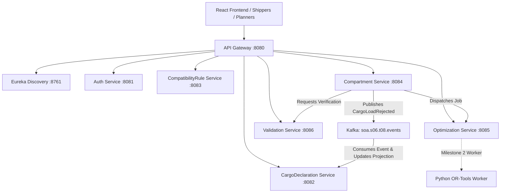

# Service Boundaries & Architecture Ownership

## 1. Domain Ownership Principles

In adherence with strict Service-Oriented Architecture (SOA) and Domain-Driven Design (DDD) principles:
- **No Shared Databases:** Each Spring Boot service strictly owns its schema and tables. No service may read or write another service's database directly.
- **Inter-service Communication:** Synchronous communication uses REST APIs over HTTPS/HTTP via Eureka Service Discovery and Spring Cloud Gateway. Asynchronous communication and event publication use Apache Kafka.
- **Idempotency & Resilience:** All state-altering endpoints accept idempotency keys or correlation IDs. Asynchronous event consumers persist consumed event IDs to ensure strict exactly-once or idempotent at-least-once business processing.

---

## 2. Service Inventory & Responsibilities

### 1. `service-discovery` (Port 8761)
- **Technology:** Spring Cloud Netflix Eureka Server.
- **Responsibility:** Dynamic registry and health discovery for all backend microservices.

### 2. `api-gateway` (Port 8080)
- **Technology:** Spring Cloud Gateway.
- **Responsibility:** Unified external API entry point, route forwarding, centralized CORS policies, JWT signature verification at perimeter, request correlation ID generation (`X-Correlation-ID`).

### 3. `auth-service` (Port 8081)
- **Technology:** Spring Boot, Spring Security, JJWT, MySQL/H2.
- **Responsibility:** User identities, BCrypt password hashing, JWT token issuance with role claims (`ROLE_SHIPPER`, `ROLE_LOAD_PLANNER`, `ROLE_ADMIN`), and token validation endpoints (`/api/v1/auth/login`, `/api/v1/auth/me`).

### 4. `cargo-declaration-service` (Port 8082)
- **Technology:** Spring Boot, Spring Data JPA, Spring Kafka, MySQL/H2.
- **Responsibility:**
  - Owner of cargo declarations, items, handling units, versions, physical dimensions, hazard classifications (UN numbers, hazard classes), and shipper ownership.
  - Maintains a downstream read-optimized projection of declaration assessment status (`DRAFT`, `OPTIMIZING`, `PENDING_APPROVAL`, `APPROVED`, `REJECTED`).
  - Consumes `CargoLoadRejected` event from `soa.s06.t08.events` to update declaration workflow projection.

### 5. `compatibility-rule-service` (Port 8083)
- **Technology:** Spring Boot, Spring Data JPA, MySQL/H2.
- **Responsibility:**
  - Typed rule definitions (segregation requirements, class incompatibilities, distance thresholds, protective packaging rules).
  - Rule governance, audit trail, provenance, jurisdiction tags (e.g., India CMV Rules / synthetic test rules).
  - Publishes immutable rule snapshots identified by unique snapshot IDs and content digests.

### 6. `compartment-service` (Port 8084)
- **Technology:** Spring Boot, Spring Data JPA, Spring Kafka, MySQL/H2.
- **Responsibility:**
  - **Assessment Workflow Orchestrator:** Manages the full state machine from candidate generation through human approval/rejection.
  - Generates immutable canonical layout versions with SHA-256 content digests.
  - Persists human approval and rejection records with planner identity, timestamp, and structured rationale.
  - **Transactional Outbox:** Reliably records and dispatches domain events (notably `CargoLoadRejected`) to Kafka topic `soa.s06.t08.events`.

### 7. `optimization-service` (Port 8085)
- **Technology:** Spring Boot, Spring Data JPA, MySQL/H2.
- **Responsibility:**
  - Durable optimization jobs, execution attempts, solver parameters, timeout control.
  - Status management: `SUBMITTED`, `RUNNING`, `COMPLETED`, `FAILED`, `TIMEOUT`.
  - Solver status: `OPTIMAL`, `FEASIBLE`, `INFEASIBLE`, `UNKNOWN`, `TIMEOUT`.
  - **Milestone 1 Stub:** Houses a deterministic, independently testable controlled stub clearly identified with `provenance: CONTROLLED_STUB` for verifiable end-to-end integration without false optimization claims.

### 8. `validation-service` (Port 8086)
- **Technology:** Spring Boot, Spring Data JPA, MySQL/H2.
- **Responsibility:**
  - **Independent Validation:** Strictly checks candidate 3D packing layouts without trusting optimizer claims.
  - Verifies:
    1. Coordinate bounds (all items fit within compartment `(L, W, H)`).
    2. 3D Axis-Aligned Bounding Box (AABB) pairwise non-overlap.
    3. Permitted 90-degree axis orientations.
    4. Compartment mass and volume payload capacity.
    5. Item quantity conservation (no missing or duplicated items).
    6. Hazard segregation based on the exact pinned rule snapshot.
  - Emits structured validation findings with failure codes (e.g., `OVERLAP_DETECTED`, `OUT_OF_BOUNDS`, `HAZARD_SEGREGATION_VIOLATION`, `CAPACITY_EXCEEDED`).
