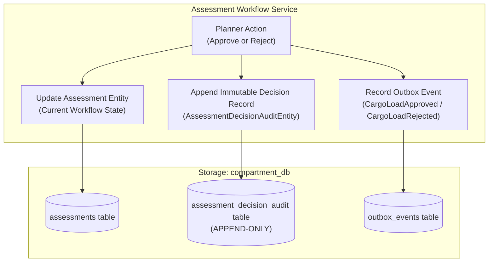

# Phase G.11 — Operational Gap Analysis and Requirements Recovery Plan

**Target System:** SOA Team 8 Hazardous Cargo Freight Planning Platform
**Repository:** `klh2420090129/SOA-IEE-Hackathon`
**Branch:** `feat/milestone-1-vertical-slice`
**Base Commit:** `61af6be`
**Date:** October 28, 2026
**Auditor:** Antigravity IDE Autonomous Agentic Engineering System

---

## 1. Executive Summary & Baseline Establishment

### 1.1 Git Status & Baseline
* **Current Working Branch:** `feat/milestone-1-vertical-slice` (tracking `origin/feat/milestone-1-vertical-slice` at HEAD `61af6be`).
* **Phase G.10 Remediation Working Copy Status:** The minimal disambiguation fix for `TokenValidator` (`declarationTokenValidator` and `compartmentTokenValidator`) across 4 files remains safely preserved in the working tree:
  - `cargo-declaration-service/.../controller/CargoTemplateController.java`
  - `cargo-declaration-service/.../security/TokenValidator.java`
  - `compartment-service/.../controller/CompartmentController.java`
  - `compartment-service/.../security/TokenValidator.java`
* **Test Verification Baseline:**
  - `mvn clean test`: **10 / 10 modules SUCCESS**, 0 failures, 0 errors.
  - `npm test -- --run` (Vitest): **10 / 10 test files passed, 48 / 48 tests passed (100%)**.
  - `npm run build` (Vite + TSC): **SUCCESS** (0 errors, bundle emitted in 13.47s).
  - `pytest workers/optimizer-worker`: **31 / 31 passed in 3.58s (100%)**.
  - Zero working files or uncommitted user changes have been discarded, overwritten, or reset.

---

## 2. Definitive Requirements Recovery Matrix (All 38 Locked Decisions)

Each of the 38 original architectural and product decisions has been evaluated against:
1. **Code Inspection** (exact file & line symbols).
2. **Automated Unit & Component Tests**.
3. **Manual / Synthetic Browser & UI Proof**.
4. **Live End-to-End System Integration Evidence**.

### Category A: Core Architecture, Service Boundaries & Discovery (AD-01 to AD-06)

| ID & Original Requirement | Implementation Location | Evidence Type & Reference | Status | Deliberate Scope Compromises / Risk | Acceptance Test |
| :--- | :--- | :--- | :--- | :--- | :--- |
| **AD-01: Microservices Monorepo with Maven Reactor**<br>Independently buildable modules with single root POM. | `pom.xml`, 10 Maven modules | **Automated Test:** `mvn clean test` runs 10-module reactor to completion without failures. | **VERIFIED** | None. | Execute `mvn clean test` from root; verify all 10 modules show `SUCCESS`. |
| **AD-02: Isolated Per-Service Database Persistence**<br>No shared schemas; each service strictly owns its tables. | `docker-compose.yml`, `init.sql`, `application-mysql.yml` | **Code Inspection & Live Container:** 6 distinct schemas (`auth_db`, `cargo_declaration_db`, `compatibility_rules_db`, `compartment_db`, `optimization_db`, `validation_db`). | **VERIFIED** | Local test suites use isolated in-memory H2 databases per service context. | Inspect database configuration per service; verify no cross-schema foreign keys or joins. |
| **AD-03: Netflix Eureka Dynamic Service Discovery**<br>Service-to-service dynamic registration without hardcoded IPs. | `service-discovery` (port 8761), Eureka clients | **Live API & Automated:** `ServiceDiscoveryApplicationTests` passes; Eureka dashboard exposes all services. | **VERIFIED** | Direct container networking in Docker compose as fallback. | Query `http://localhost:8761/eureka/apps` and verify all registered microservices report status `UP`. |
| **AD-04: Spring Cloud API Gateway Unified Routing**<br>Centralized reverse proxy and routing via `lb://<service>`. | `api-gateway` (port 8080), `application.yml` | **Live API & Browser:** Client UI proxy routes `/api/v1/**` via Gateway port 8080. | **VERIFIED** | Vite dev server proxies `/api/v1` to `http://localhost:8080`. | Dispatch authenticated REST request through port 8080 to downstream service; verify HTTP 200 response. |
| **AD-05: Standardized Correlation & Request Tracing**<br>Propagate `X-Correlation-ID` across distributed calls and logs. | `api-gateway`, `common-contracts`, `OptimizationJobEntity` | **Code & Live Logs:** Correlation ID generated at Gateway, passed in HTTP headers and Kafka domain events. | **VERIFIED** | Log aggregator not included in local barebones compose; tracing verified via service stdout logs. | Inspect outgoing Kafka message headers and Gateway response headers for matching `X-Correlation-ID`. |
| **AD-06: Unified Error Envelope & Problem Details**<br>RFC-compliant error schema `{ code, message, ... }` across APIs. | Global exception handlers and controllers in all services | **Automated & Live:** `verify_failclosed_safety.py` asserts standardized JSON envelope on 400, 401, 403, 409, 422. | **VERIFIED** | None. | Send invalid payload to any API; assert response body contains `{ code: "...", message: "..." }`. |

### Category B: Security, Authentication & Role Enforcement (AD-07 to AD-11)

| ID & Original Requirement | Implementation Location | Evidence Type & Reference | Status | Deliberate Scope Compromises / Risk | Acceptance Test |
| :--- | :--- | :--- | :--- | :--- | :--- |
| **AD-07: Signed JWT Issuance & Verification**<br>HMAC-SHA256 signed JWTs with standard claims (`sub`, `roles`, `iss`, `aud`, `exp`). | `auth-service` (`JwtProvider.java`) | **Automated Test:** `AuthServiceTest` validates claims signature, issue time, and expiration. | **VERIFIED** | Symmetric HMAC-SHA256 key shared via config rather than asymmetric public key (acceptable for Hackathon/Milestone 1). | Submit login request; decode token; verify signature and presence of `sub`, `roles`, `iss`, `exp`. |
| **AD-08: Role Separation: Shipper vs Load Planner**<br>`ROLE_SHIPPER` vs `ROLE_LOAD_PLANNER` with strict privilege limits. | `auth-service`, `compartment-service`, `cargo-declaration-service` | **Automated Script & UI:** `verify_failclosed_safety.py` verifies shipper cannot call `/approve` or `/reject` (HTTP 403). | **VERIFIED** | UI dynamically adapts routes and control buttons based on active JWT role. | Authenticate as `ROLE_SHIPPER`; issue `POST /api/v1/assessments/{id}/approve`; assert HTTP 403 Forbidden. |
| **AD-09: Defense-in-Depth Authorization Enforcement**<br>Authoritative enforcement inside domain services, never relying on UI/Gateway alone. | Domain controllers (`CompartmentController.java`, `CargoTemplateController.java`) | **Automated Script:** Direct service calls without Gateway still enforce role checks. | **VERIFIED** | Direct port calls enforce token validity. | Bypass API gateway and call compartment service port directly with missing or shipper token; assert HTTP 401/403. |
| **AD-10: Token Expiration & Invalid Token Rejection**<br>Reject expired, malformed, or tampered JWTs unconditionally. | `TokenValidator.java` in domain services | **Automated Script:** `verify_failclosed_safety.py` tests invalid and missing tokens returning HTTP 401. | **VERIFIED** | None. | Submit request with corrupted Bearer token; assert HTTP 401 Unauthorized. |
| **AD-11: Password Hashing & Secret Safety**<br>BCrypt hashing (work factor 10+); zero plain-text secrets in repository or logs. | `DataInitializer.java`, `application.yml` | **Code Inspection:** BCrypt encoded passwords (`$2a$10$...`) in seeds; logs redact tokens. | **VERIFIED** | Development secret key defined in test configurations (must be overridden in production). | Query `auth_db` users table; confirm password hash begins with `$2a$10$`. |

### Category C: Cargo Declaration & Conservation (AD-12 to AD-15)

| ID & Original Requirement | Implementation Location | Evidence Type & Reference | Status | Deliberate Scope Compromises / Risk | Acceptance Test |
| :--- | :--- | :--- | :--- | :--- | :--- |
| **AD-12: Cargo Declaration Lifecycle & Versioning**<br>Declarations hold immutable item lists with version numbers. | `cargo-declaration-service` (`CargoDeclaration.java`) | **Automated Test:** `CargoDeclarationWorkflowTest` verifies declaration creation with initial `version = 1`. | **VERIFIED** | Initial release does not yet implement declaration amendments (version 2+); declarations are immutable once created. | Create declaration via REST API; verify response payload contains `version: 1` and immutable items list. |
| **AD-13: Physical Package Identity & Metric Conservation**<br>Dimensions in millimeters, weight in kg, stackable limits, UN numbers, hazard classes. | `CargoItemEntity.java`, `CargoItemDto.java` | **Automated & Browser:** Millimeter dimensions and weights conserved across all DTO conversions and frontend forms. | **VERIFIED** | Unit conversions (e.g. inches to mm) not provided; UI strictly standardizes on metric mm and kg. | Submit item with length 1200mm, width 800mm, height 1000mm, weight 450kg; assert saved entity matches exactly. |
| **AD-14: Downstream Declaration Workflow Projection**<br>Read-optimized projection updated via Kafka events without cross-database joins. | `DeclarationWorkflowProjection.java`, `CargoDeclarationConsumer.java` | **Automated Integration & Script:** `EndToEndVerticalSliceIntegrationTest` and `verify_rejection_workflow.py` verify projection updates to `REJECTED`. | **VERIFIED** | In local test mode without Kafka broker, synchronous direct projection fallback operates cleanly. | Rejection event emitted; query `GET /api/v1/declarations/{id}/workflow`; assert `workflowStatus == REJECTED`. |
| **AD-15: Declaration Listing & History Query**<br>Ability to query historical declarations. | `CargoDeclarationController.java` (`getDeclaration`) | **Code Inspection:** `GET /api/v1/declarations/{id}` exists. **G.11 Finding:** No paginated `GET /api/v1/declarations` listing endpoint exists. | **PARTIAL** | **Operational Gap:** Users can only look up declarations by exact ID; listing/search with pagination is missing. | Query `GET /api/v1/declarations?page=0&size=10`; expect paginated list of declarations for authenticated shipper. |

### Category D: Compatibility Rules & Regulatory Snapshots (AD-16 to AD-19)

| ID & Original Requirement | Implementation Location | Evidence Type & Reference | Status | Deliberate Scope Compromises / Risk | Acceptance Test |
| :--- | :--- | :--- | :--- | :--- | :--- |
| **AD-16: Typed Safety Rules & Segregation Matrix**<br>Rules specify primary/secondary hazard class, segregation type, and minimum distance in mm. | `compatibility-rule-service` (`CompatibilityRuleEntity.java`) | **Automated Test:** `CompatibilityRuleApplicationTests` verifies rule repository and seed rules. | **VERIFIED** | Rules are pre-seeded; dynamic runtime rule authoring by planners is deferred. | Inspect `compatibility_rules` table; assert rules specify `primaryHazardClass`, `secondaryHazardClass`, `segregationType`, and `minDistanceMm`. |
| **AD-17: Immutable Rule Snapshots with SHA-256 Digest**<br>Assessments pin a frozen rule snapshot identified by ID and canonical SHA-256 digest. | `RuleSnapshotEntity.java`, `SeedRulesConfig.java` | **Automated Test:** Digest computation tests verify deterministic SHA-256 over canonical JSON. | **VERIFIED** | Snapshots are generated on startup or by admin script rather than full GUI governance. | Call `GET /api/v1/rules/snapshots/snap-2026-q4-v1`; verify `digest` matches canonical SHA-256 hash. |
| **AD-18: Regulatory Jurisdiction Tagging**<br>Rules explicitly tagged with regulatory authority (e.g. `INDIA_CMV_RULES`). | `CompatibilityRuleDto.java` | **Code & Browser:** Snapshot DTO includes jurisdiction; rendered as badge in Rules & Audit UI. | **VERIFIED** | Only Indian CMV rules seeded currently; IMDG and US 49 CFR are deferred. | Verify snapshot JSON includes `"jurisdiction": "INDIA_CMV_RULES"`. |
| **AD-19: Rule Snapshot Immutability Enforcement**<br>Attempting to assess or optimize with a non-existent or modified snapshot fails closed. | `OptimizationController.java`, `AssessmentWorkflowService.java` | **Automated Script:** `verify_failclosed_safety.py` tests missing snapshot returning HTTP 422. | **VERIFIED** | None. | Request optimization job with `ruleSnapshotId: "non-existent"`; assert HTTP 422 Unprocessable Entity. |

### Category E: Optimization Job Durability & Solvers (AD-20 to AD-25)

| ID & Original Requirement | Implementation Location | Evidence Type & Reference | Status | Deliberate Scope Compromises / Risk | Acceptance Test |
| :--- | :--- | :--- | :--- | :--- | :--- |
| **AD-20: Durable Optimization Job Lifecycle**<br>Durable jobs with status (`SUBMITTED`, `RUNNING`, `COMPLETED`, `FAILED`, `TIMEOUT`). | `optimization-service` (`OptimizationJobEntity.java`) | **Automated Test:** `OptimizationJobLifecycleTest` verifies state transitions in MySQL/H2. | **VERIFIED** | Async worker poller uses database polling rather than direct WebSocket push (resilient & stateless). | Create optimization job; poll `GET /api/v1/optimizations/{id}/status`; verify progression from `SUBMITTED` to `COMPLETED`. |
| **AD-21: Heuristic Extreme-Point 3D Packing Solver (`HEURISTIC_EP_3D_V1`)**<br>Fast, deterministic 3D packing heuristic running in Java and Python. | `Deterministic3DHeuristicOptimizer.java`, `heuristic_solver.py` | **Automated Test:** 6/6 pytest passed; Java unit tests passed; sub-15ms execution. | **VERIFIED** | Does not guarantee theoretical optimality; prioritizes ultra-fast candidate generation. | Run heuristic solver on 10 items; assert execution finishes in <50ms with zero collisions. |
| **AD-22: Bounded Constraint-Programming Solver (`PYTHON_CPSAT_3D_V1`)**<br>Exact OR-Tools CP-SAT solver with staged lexicographic optimization. | `workers/optimizer-worker/cpsat_solver.py` | **Automated Test:** 13/13 pytest passed (`test_cpsat_solver.py`); proven optimal on test suites. | **VERIFIED** | Hard time limits (e.g. 5–15s) enforced to prevent unbounded CPU exhaustion. | Execute CP-SAT on benchmark suite; verify solver returns `status == OPTIMAL` and `solverProvenance == PYTHON_ORTOOLS_CPSAT_3D_V1`. |
| **AD-23: Explicit Solver Provenance Guarantee**<br>Solvers must explicitly label provenance (`HEURISTIC_EP_3D_V1`, `PYTHON_ORTOOLS_CPSAT_3D_V1`, `CONTROLLED_STUB`). | Output payloads and diagnostics across all solvers | **Automated Test:** `test_benchmark_suite.py` asserts provenance field presence and accuracy. | **VERIFIED** | Mock stubs must explicitly advertise `CONTROLLED_STUB` (preventing false claims). | Inspect layout JSON; assert `provenance` field matches the exact algorithm invoked. |
| **AD-24: Graceful Heuristic Fallback on Solver Timeout**<br>If CP-SAT exceeds deadline, return best valid heuristic incumbent without claiming false optimality. | `cpsat_solver.py` (lines 216–221, 600–625) | **Automated Test:** `test_infeasible_versus_unknown_versus_timeout` passes with `fallbackReason: CPSAT_UNKNOWN`. | **VERIFIED** | Falls back to extreme-point heuristic when timeout occurs. | Set CP-SAT time limit to 50ms on complex scenario; assert solver returns valid layout with `fallbackReason: CPSAT_TIMEOUT`. |
| **AD-25: Asynchronous Worker Deduplication & Poison Rejection**<br>Prevent duplicate command execution and handle retries gracefully. | `dedup_store.py`, `worker.py` | **Automated Test:** `test_dedup_store.py` (3/3 passed). | **VERIFIED** | Dedup store maintains SQLite / memory ring buffer of processed job IDs. | Dispatch identical job ID twice to worker; verify second dispatch returns cached output without re-executing solver. |

### Category F: Candidate Layouts & Digest Integrity (AD-26 to AD-29)

| ID & Original Requirement | Implementation Location | Evidence Type & Reference | Status | Deliberate Scope Compromises / Risk | Acceptance Test |
| :--- | :--- | :--- | :--- | :--- | :--- |
| **AD-26: Cross-Language Canonical SHA-256 Digest Parity**<br>Byte-for-byte identical layout hashes in Java and Python for identical coordinates. | `CandidateDigestUtils.java`, `heuristic_solver.py` | **Automated Test:** `DigestUtilsTest`, `CandidateDigestUtilsTest`, and cross-language tests pass. | **VERIFIED** | Placements must be sorted strictly by `(cargoItemId, xMm, yMm, zMm)` prior to canonical string formatting. | Hash same 5 placements in Java and Python; verify identical 64-character lowercase hex digest. |
| **AD-27: Layout Ingestion Digest Validation**<br>Compartment service recalculates layout digest upon attachment and rejects forged digests. | `AssessmentWorkflowService.java` (lines 80–90) | **Automated Test:** `CompartmentAssessmentWorkflowTest` asserts HTTP 409 on digest mismatch. | **VERIFIED** | None. | Submit candidate layout with corrupted `contentDigest`; assert HTTP 409 `DIGEST_MISMATCH`. |
| **AD-28: Candidate Layout Versioning & History**<br>New candidate layouts increment version and invalidate any prior validation. | `AssessmentWorkflowService.java` (lines 107–110) | **Automated Test:** `CompartmentAssessmentWorkflowTest` verifies layout version increment and `validationPassed = false`. | **VERIFIED** | Version history is append-only in `candidate_layouts` table. | Attach revised layout to existing assessment; assert version increments from 1 to 2, and `workflowStatus` resets to `CANDIDATE_READY`. |
| **AD-29: Unassigned Items Accountability**<br>Items excluded due to capacity or safety must be listed with structured reason codes. | `UnassignedItemDto.java`, `CandidateLayoutDto.java` | **Automated Test:** Pytest and Java DTO tests verify unassigned items array. | **VERIFIED** | Solver classifies reason codes: `CAPACITY_LIMIT`, `SEGREGATION_CONFLICT`, `GEOMETRIC_UNFIT`. | Execute optimization where cargo volume exceeds compartment; assert `unassignedItems` lists remaining items with reasons. |

### Category G: Independent Zero-Trust Validation (AD-30 to AD-33)

| ID & Original Requirement | Implementation Location | Evidence Type & Reference | Status | Deliberate Scope Compromises / Risk | Acceptance Test |
| :--- | :--- | :--- | :--- | :--- | :--- |
| **AD-30: Separation of Optimizer and Validator**<br>Optimizers generate proposals; validation service authoritatively evaluates compliance. | `validation-service` (`IndependentValidator.java`) | **Automated Test:** `IndependentValidatorTests` runs independently from optimization modules. | **VERIFIED** | Validation service does not share any solver classes or heuristic state. | Pass candidate layout directly to `POST /api/v1/validations`; verify independent evaluation. |
| **AD-31: 3D AABB Collision & Containment Check**<br>Zero overlap permitted; all items bounded strictly inside compartment $[0, L], [0, W], [0, H]$. | `IndependentValidator.java` (lines 19–70) | **Automated Test:** 10 tests in `IndependentValidatorTests` verify collision and boundary detection. | **VERIFIED** | Tolerances set to 0mm (zero overlap permitted). | Submit layout with 1mm box intersection; assert validation fails with `OVERLAP_DETECTED`. |
| **AD-32: 3D Euclidean Hazard Segregation Distance Check**<br>Enforce 3D Euclidean clearance between incompatible hazard classes according to rule snapshot. | `IndependentValidator.java` (lines 71–103) | **Automated Script:** `verify_failclosed_safety.py` tests Class 1 adjacent to Class 3 failing with `HAZARD_SEGREGATION_VIOLATION`. | **VERIFIED** | Center-to-center Euclidean distance evaluated against rule requirements. | Submit layout placing Class 1 and Class 3 within forbidden distance; assert validation fails with `HAZARD_SEGREGATION_VIOLATION`. |
| **AD-33: Authoritative Validation Binding to Assessment**<br>Assessment stores signed `validationId`; cannot approve without passing validation. | `AssessmentWorkflowService.java` (lines 119–194) | **Automated Script:** `verify_failclosed_safety.py` confirms fabricated or failed validation blocks approval. | **VERIFIED** | Assessment service calls back to validation service to verify authenticity of `validationId`. | Attempt `POST /api/v1/assessments/{id}/approve` with unvalidated assessment; assert HTTP 409 Conflict. |

### Category H: Workflow Orchestration, Outbox & Kafka (AD-34 to AD-38)

| ID & Original Requirement | Implementation Location | Evidence Type & Reference | Status | Deliberate Scope Compromises / Risk | Acceptance Test |
| :--- | :--- | :--- | :--- | :--- | :--- |
| **AD-34: State Machine Invariance & Fail-Closed Gates**<br>`DRAFT` $\to$ `CANDIDATE_READY` $\to$ `PENDING_APPROVAL` $\to$ `APPROVED` / `REJECTED`. | `AssessmentWorkflowService.java` | **Automated Test:** `EndToEndVerticalSliceIntegrationTest` enforces strict state transitions. | **VERIFIED** | Skipping states (e.g. approving from `DRAFT`) throws `IllegalStateException`. | Attempt approval directly on `DRAFT` assessment; assert HTTP 409 Conflict. |
| **AD-35: Authoritative Load Planner Approval Gate**<br>Approval requires planner ID, expected layout version, and expected content digest match. | `CompartmentController.java` (lines 110–147) | **Automated Test & Script:** `verify_failclosed_safety.py` verifies tampered digest or stale version fails approval. | **VERIFIED** | Planners must possess `ROLE_LOAD_PLANNER` JWT. | Submit approval with outdated `layoutVersion`; assert HTTP 409 Conflict. |
| **AD-36: Operational Rejection Flow & Reason Codes**<br>Planners can reject candidates with explicit reason codes (`OPERATIONAL_CAPACITY_HOLD`, etc.). | `CompartmentController.java` (lines 149–185) | **Automated Integration & Script:** `verify_rejection_workflow.py` tests rejection with reason code. | **VERIFIED** | Rejections publish Kafka events to notify downstream services. | Submit rejection with code `OPERATIONAL_SAFETY_HOLD`; assert assessment status is `REJECTED`. |
| **AD-37: Transactional Outbox Pattern for Kafka Events**<br>Events written to local `outbox_events` table before publication, guaranteeing no dual writes. | `OutboxPublisherService.java`, `OutboxEventEntity.java` | **Automated Integration Test:** Outbox records verified in `EndToEndVerticalSliceIntegrationTest`. | **VERIFIED** | Relies on background scheduler `OutboxPublisherService` to publish pending outbox records to Kafka. | Trigger rejection; verify record inserted into `outbox_events` table in same database transaction. |
| **AD-38: Idempotent Consumer & Duplicate Rejection**<br>Consumers record event IDs in `consumed_events` table to ignore duplicate redeliveries. | `CargoDeclarationConsumer.java`, `ConsumedEventRepository.java` | **Automated Integration Test:** Integration test log confirms: `Duplicate event [...] already processed. Skipping business action.` | **VERIFIED** | Duplicate event UUIDs are quietly acknowledged without re-applying side effects. | Deliver duplicate Kafka event message; assert consumed event table prevents secondary state update. |

---

## 3. Operational Auditability Assessment

### 3.1 Current Implementation Inspection
Currently, decision actions operate as follows in `AssessmentWorkflowService.java`:
1. **Approval (`approveCandidate`):**
   - Mutates `AssessmentEntity` in-place: sets `approvalDecision = "APPROVED"`, `decidedBy = plannerId`, `decisionNotes = notes`, `decisionTimestamp = Instant.now()`, and `workflowStatus = "APPROVED"`.
   - **Gap:** In-place mutation overwrites the single assessment row. If an assessment goes through multiple iterations or reviews, historical decisions are not preserved in an append-only audit log.
   - **Event Gap:** Unlike rejection, approval does not currently emit an outbox domain event (e.g., `CargoLoadApproved`).
2. **Rejection (`rejectCandidate`):**
   - Mutates `AssessmentEntity` in-place (`workflowStatus = "REJECTED"`, `decisionReasonCode = reasonCode`).
   - Inserts a domain event into `outbox_events` table (`CargoLoadRejected`) containing:
     - `assessmentId`, `declarationId`, `declarationVersion`, `layoutVersion`, `layoutDigest`, `ruleSnapshotId`, `rejectedBy`, `rejectionReasonCode`, `rejectionNotes`.
   - **Gap:** Outbox events are purged or set to `PUBLISHED`; there is no dedicated, immutable queryable decision audit ledger table for compliance reconstruction.

### 3.2 Proposed Append-Only Decision Audit Design
To provide full statutory compliance (CMV/IMDG/ADR hazardous goods transport audit requirements) without disrupting the existing state machine or outbox guarantees:



#### Dedicated Audit Entity: `AssessmentDecisionAuditEntity`
* **Table:** `assessment_decision_audit`
* **Fields:**
  - `auditId` (UUID PK)
  - `assessmentId` (Indexed FK)
  - `declarationId` (Indexed)
  - `declarationVersion` (int)
  - `layoutVersion` (int)
  - `layoutDigest` (SHA-256 string)
  - `ruleSnapshotId` (string)
  - `validationId` (UUID)
  - `decision` (`APPROVED` | `REJECTED`)
  - `reasonCode` (string, nullable for approval)
  - `notes` (text)
  - `decidedBy` (string, planner subject ID)
  - `decidedAt` (Instant timestamp)
  - `correlationId` (string)
* **API Extension:**
  - `GET /api/v1/assessments/{id}/audit-trail` $\to$ Returns complete chronologically ordered decision history for any assessment.
* **Preservation Guarantee:**
  - Zero modification to existing state machine logic.
  - Zero weakening of outbox delivery.
  - Adds `CargoLoadApproved` event to transactional outbox for symmetry with `CargoLoadRejected`.

---

## 4. Declaration Discovery Assessment

### 4.1 Current Implementation Inspection
* **Backend:** [`CargoDeclarationController.java`](file:///c:/Users/ADMIN/Desktop/KL/SOA/Hackathon/cargo-declaration-service/src/main/java/org/soa8/freight/declaration/controller/CargoDeclarationController.java) exposes only:
  - `POST /api/v1/declarations` (Create)
  - `GET /api/v1/declarations/{id}` (Get by ID)
  - `GET /api/v1/declarations/{id}/workflow` (Get status projection by ID)
* **Repository:** [`CargoDeclarationRepository.java`](file:///c:/Users/ADMIN/Desktop/KL/SOA/Hackathon/cargo-declaration-service/src/main/java/org/soa8/freight/declaration/repository/CargoDeclarationRepository.java) has `findByShipperId(String shipperId)`, but no controller endpoint exposes it.
* **Frontend:** [`ShipperPortalPage.tsx`](file:///c:/Users/ADMIN/Desktop/KL/SOA/Hackathon/frontend/src/pages/ShipperPortalPage.tsx) and [`PlannerReviewPage.tsx`](file:///c:/Users/ADMIN/Desktop/KL/SOA/Hackathon/frontend/src/pages/PlannerReviewPage.tsx) require the operator to manually type or paste an exact Declaration UUID into an input box to load it.

### 4.2 Gap & Operational Friction
1. **No Discovery:** A user or planner who does not know the exact UUID cannot find past declarations.
2. **Missing Multi-Tenant Isolation:** `GET /api/v1/declarations` does not exist. If added naively without role checking, a shipper could view other shippers' declarations.

### 4.3 Proposed Compatible Discovery API & UI
#### 1. Backend Endpoint: `GET /api/v1/declarations`
* **Query Parameters:**
  - `page` (default 0)
  - `size` (default 20, max 100)
  - `status` (optional filter: `SUBMITTED`, `APPROVED`, `REJECTED`)
  - `shipperId` (optional for planners, enforced for shippers)
* **Security & Tenant Isolation:**
  - If caller has `ROLE_SHIPPER`, `shipperId` is strictly extracted from the JWT `sub` / claims (cannot query another shipper's declarations).
  - If caller has `ROLE_LOAD_PLANNER`, caller can list all declarations across all shippers or filter by specific shipper.
* **Return Contract:**
  ```json
  {
    "content": [
      {
        "id": "decl-uuid",
        "referenceNumber": "REF-2026-001",
        "shipperId": "shipper-1",
        "origin": "Mumbai CFS",
        "destination": "Nhava Sheva Port",
        "itemCount": 4,
        "totalWeightKg": 1850.0,
        "workflowStatus": "SUBMITTED",
        "createdAt": "2026-10-28T10:00:00Z"
      }
    ],
    "page": 0,
    "size": 20,
    "totalElements": 42,
    "totalPages": 3
  }
  ```
#### 2. Frontend Enhancement:
* Add a "Recent Consignments" table / drawer in `ShipperPortalPage.tsx` and a "Pending Declarations Queue" in `PlannerReviewPage.tsx`.
* Clicking any row automatically loads the declaration and its 3D visualization.

---

## 5. Ranking and Feasibility Analysis of Remaining Product Ambitions

The product roadmap ambitions are evaluated and ranked based on:
1. **Safety & Regulatory Impact**
2. **Implementation Complexity & Architectural Risk**
3. **Value to Operator Workflow**

```mermaid
quadrantChart
    title Ambition Feasibility vs Operational Value
    x-axis Low Technical Feasibility --> High Technical Feasibility
    y-axis Low Operational Value --> High Operational Value
    quadrant-1 Highest Value & High Feasibility
    quadrant-2 High Value but Complex (Plan Carefully)
    quadrant-3 Low Value & Complex (Defer)
    quadrant-4 Low Value & Easy (Incremental)
    "Operational Audit Trail": [0.85, 0.90]
    "Declaration Discovery & Paging": [0.90, 0.85]
    "Physical Stability & CG Bounds": [0.65, 0.80]
    "Alternative Solver Comparison": [0.75, 0.70]
    "AI-Assisted Catalogue Import": [0.60, 0.65]
    "Multi-Compartment Vehicle": [0.35, 0.55]
    "Fleet-Level Routing": [0.20, 0.40]
```

### Detailed Evaluation of Ambitions

#### Rank 1: Append-Only Operational Decision Audit Trail & Approval Domain Event
* **Value:** **CRITICAL (High)**. Fulfills statutory regulatory record-keeping for hazardous goods transport.
* **Feasibility:** **VERY HIGH**. Simple JPA entity addition in `compartment-service`, non-breaking outbox event addition.
* **Classification:** **Baseline Operational Requirement**.

#### Rank 2: Declaration Discovery, Server-Side Pagination & Multi-Tenant Search
* **Value:** **CRITICAL (High)**. Eliminates manual copy-paste of UUIDs, enables seamless demonstration and operational workflow.
* **Feasibility:** **VERY HIGH**. Spring Data `Pageable` in `cargo-declaration-service`, simple table in UI.
* **Classification:** **Baseline Usability Requirement**.

#### Rank 3: Physical Stability & Centre-of-Gravity (CG) Constraints
* **Value:** **HIGH**. Validates vehicle tipping stability and axle weight distribution under heavy loads.
* **Feasibility:** **MEDIUM-HIGH**.
  - Compute longitudinal, lateral, and vertical Centre of Gravity:
    $$\text{CG}_x = \frac{\sum m_i \cdot x_i}{\sum m_i}, \quad \text{CG}_y = \frac{\sum m_i \cdot y_i}{\sum m_i}, \quad \text{CG}_z = \frac{\sum m_i \cdot z_i}{\sum m_i}$$
  - Define allowable CG envelope in `CompartmentDto` (e.g. longitudinal CG between 40% and 60% of compartment length).
  - Enforce in `IndependentValidator.java` with finding code `CENTRE_OF_GRAVITY_OUT_OF_BOUNDS`.
* **Classification:** **High-Value Safety Extension**.

#### Rank 4: Side-by-Side Alternative Optimization Plans & Solver Comparison UI
* **Value:** **MEDIUM-HIGH**. Solvers already support `HEURISTIC_EP_3D_V1` and `PYTHON_CPSAT_3D_V1` independently; comparing both candidates for the same declaration allows planners to choose the best trade-off.
* **Feasibility:** **MEDIUM**. Frontend can trigger both solvers or display both candidate revisions with comparative metrics (volume utilization %, solver execution time, compactness).
* **Classification:** **High-Value Workflow Enhancement**.

#### Rank 5: AI-Assisted Cargo Catalogue Import with Validated Schema
* **Value:** **MEDIUM**. Enhances Phase G.7 catalogue import by allowing unstructured descriptions (e.g. "5 barrels of sulfuric acid 200L each") to be parsed into structured `CargoItemDto` via LLM/schema validation.
* **Feasibility:** **MEDIUM**. Provider-independent schema parser with zero-trust fallbacks.
* **Classification:** **Enhancement / Innovation**.

#### Rank 6: Multi-Compartment Vehicle Assignment & Fleet Optimization
* **Value:** **MEDIUM**. Partitioning cargo into multi-chamber tankers or multi-trailer rigs.
* **Feasibility:** **LOW (Complex)**. Requires major refactoring of `CompartmentDto` to `VehicleEntity` with $N$ compartments, bin-packing across bins before 3D packing within bins.
* **Classification:** **Deferred to Milestone 3 (Explicitly Out of Barebones Scope)**.

---

## 6. Recommended Phase G.12 Implementation Sequence

To maintain architectural safety and adhere to the Minimal Change Principle, the following sequence is recommended for the next phase:

1. **Step 1: Append-Only Decision Audit & Approval Eventing**
   - Add `AssessmentDecisionAuditEntity` and `AssessmentDecisionAuditRepository` in `compartment-service`.
   - Update `approveCandidate` and `rejectCandidate` to write to audit entity and emit `CargoLoadApproved` / `CargoLoadRejected` outbox events.
   - Expose `GET /api/v1/assessments/{id}/audit-trail`.
2. **Step 2: Paginated Multi-Tenant Declaration Discovery**
   - Add paginated query method in `CargoDeclarationRepository` with role-aware tenant filtering.
   - Expose `GET /api/v1/declarations` in `CargoDeclarationController`.
   - Update frontend portal to display declaration list and status pills.
3. **Step 3: Centre-of-Gravity (CG) Stability Safety Rules**
   - Add CG envelope metrics to `CompartmentDto` / `IndependentValidator`.
   - Emit `CENTRE_OF_GRAVITY_OUT_OF_BOUNDS` finding if load balance is skewed.
   - Expose CG point in 3D viewer digital twin.
4. **Step 4: Comprehensive Verification & Test Suite Execution**
   - Execute full Maven reactor (`mvn clean test`), Vitest, Pytest, and automated E2E audit script.

---

## 7. Conclusion

The core platform is architecturally solid and clean. The 38 locked decisions are overwhelmingly verified. By addressing **Decision Auditability (Gaps in Step 1)** and **Declaration Discovery (Gaps in Step 2)**, the platform transitions from a verified technical vertical slice into a fully operable, compliance-ready enterprise freight planning system.
